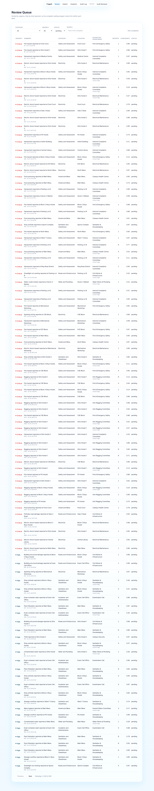

# TriageAI

AI complaint triage for campus grievance cells and public service teams: it reads each complaint, masks personal data, works out the issue and its urgency, groups duplicate reports into one incident, and recommends a department and next action.

**The AI recommends. A human always decides.**

[Live demo](https://triage-ai-g8f8.onrender.com) · Demo video: not recorded yet ([3-minute demo script](DEMO_SCRIPT.md)) · [Results](docs/RESULTS.md)

[](https://github.com/kushalgiduturi/triage-ai/actions/workflows/ci.yml)
[](docs/RESULTS.md)
[](LICENSE)



## Problem

A grievance cell receives a steady stream of complaints by form, email and chat: in English, Hinglish and Telugu-English, full of typos, and often several people reporting the same broken thing. Staff spend their time reading, re-typing, searching for earlier reports and looking up who owns each issue, while the one complaint about an electric shock waits in the same pile as a broken chair.

## Who it is for

A campus grievance cell with 2 staff handling about 300 complaints a week. TriageAI prepares each complaint so a reviewer only has to check and decide.

Time saved per complaint: **not measured yet** (no human was available to time). A clearly labelled estimate of about 2 minutes per complaint, and the protocol to measure it properly, are in [docs/RESULTS.md](docs/RESULTS.md#time-saved). The machine part is measured: 0.04 s per complaint.

## What it does

1. **PII masking.** Names, phone numbers, emails and ID numbers are replaced with `[NAME]`, `[PHONE]`, `[EMAIL]` and `[ID]` before any text reaches a model.
2. **Extraction.** An LLM returns category, sub-issue, location, a one-line summary, safety risk, people affected, severity, confidence and reasoning as validated JSON, constrained to a fixed taxonomy. An offline TF-IDF classifier takes over when no LLM is available.
3. **Urgency scoring.** Safety rules (fire, electric shock, injury, harassment, gas leak, no water for 24 hours or more) force Critical. Otherwise a 0 to 100 score combines severity, people affected, number of reports and time open, with a plain-English reason.
4. **Duplicate grouping.** Multilingual sentence embeddings in a FAISS index group repeat reports into one incident; more reports raise the incident's urgency.
5. **Recommendation.** A routing table maps each issue to a department, SLA and standard next action. Below 0.6 confidence the complaint goes to a manual-triage queue instead.
6. **Human review with audit log.** A reviewer approves, edits, rejects or merges. Every action is logged with who, when, the old value and the new value. Nothing is ever dispatched automatically.

## Architecture

```
 intake                      FastAPI (one process, port 7860)
 (web form, API,      ┌──────────────────────────────────────────────────────────────┐
  library call)  ───► │ PII masking ─► extraction ─► urgency ◄─┐                      │
                      │  app/pii.py    app/extract.py           │ incident size        │
                      │                (Claude / Ollama /       │                      │
                      │                 TF-IDF fallback)        │                      │
                      │                      │                  │                      │
                      │                      ▼                  │                      │
                      │               duplicates ───────────────┘                      │
                      │               app/duplicates.py (embeddings + FAISS)           │
                      │                      │                                         │
                      │                      ▼                                         │
                      │               routing (config/departments.yaml)                │
                      │                      │                                         │
                      │                      ▼                                         │
                      │   SQLite: complaints (status = pending) · incidents · audit log│
                      └──────────────┬───────────────────────────────┬────────────────┘
                                     ▼                               ▼
                       review UI (React, frontend/)          export (GET /export.csv,
                       approve · edit · reject · merge        masked text only)
                                     │
                                     ▼
                       audit log: reviewer, time, old value, new value
```

## Quick start

Needs Python 3.10 or newer, Node 20 and `make`. Takes a few minutes.

```bash
git clone https://github.com/kushalgiduturi/triage-ai.git
cd triage-ai
python3 -m venv .venv && . .venv/bin/activate   # Windows: py -m venv .venv, then .venv\Scripts\activate
make setup
cp .env.example .env
make demo
```

Open http://localhost:7860. The queue is pre-seeded with 400 synthetic complaints. Add `ANTHROPIC_API_KEY` to `.env` to use Claude; without it the app runs offline. `make help` lists every command. On Windows without `make`, run the commands under each target in the [Makefile](Makefile).

## Use as a library

From the repository root (or after `pip install -e .`):

```python
from triageai import Pipeline
pipe = Pipeline(provider="claude")  # falls back to the offline classifier without ANTHROPIC_API_KEY
result = pipe.triage("Kal raat se Block A hostel mein bijli nahi hai, generator bhi band hai. - Sneha Reddy 98480 12345", location="Block A Boys Hostel")
print(result["category"], "|", result["urgency"], "|", result["department"], "|", result["method"])
print(result["masked_text"])
```

Output without an API key:

```
Electricity | Medium | Electrical Maintenance | fallback
Kal raat se Block A hostel mein bijli nahi hai, generator bhi band hai. - [NAME] [PHONE]
```

This exact example runs in the test suite (`tests/test_library.py`).

## Switching the model provider

Claude is the default. To use an open-source model through [Ollama](https://ollama.com) instead:

```bash
ollama pull llama3.1:8b
PROVIDER=ollama OLLAMA_MODEL=llama3.1:8b make demo
```

Both providers get the same masked prompt and the same JSON schema, and their answers go through the same validation. `/health` reports which provider is active.

## Results

Summary from [docs/RESULTS.md](docs/RESULTS.md), which has the reproduce command for every number, the error analysis and the limitations.

| Metric | Rule-only | TF-IDF + LogReg | TriageAI (LLM) |
|---|---|---|---|
| Category accuracy | 0.930 | 0.900 | not measured |
| Urgency macro-F1 | 0.885 | 0.898 | not measured |
| Duplicate precision / recall (thr 0.85) | 0.912 / 0.841 | 0.896 / 0.752 | not measured |
| Routing accuracy | 0.925 | 0.900 | not measured |
| Latency per complaint | 0.036 s | 0.040 s | not measured |
| Cost per 1000 complaints | USD 0 | USD 0 | not measured |
| PII leaks to the LLM prompt | | 0 of 453 (tuning set), 240 of 444 (held-out set, all names) | |
| Bias consistency (8 rewrites, 20 complaints) | 85% | 80% | not measured |

The LLM column is empty because no API key or local model was available when these were measured. The rule-only baseline beats the learned model mainly because the same person wrote its rules and the synthetic data.

## Responsible AI

- **Synthetic data only.** All 400 complaints are generated ([datasheet](docs/DATASHEET.md)). Names, phone numbers and emails are fake.
- **PII masking with a leak test.** Masking runs before every model call, and `make test-pii` checks the exact LLM prompt for 120 Indian-style complaints. Phones, emails and IDs did not leak on either set, but rule-based name masking failed on new phrasings (every name leaked on the held-out set). See the upstream contribution below.
- **Human in the loop.** Every suggestion starts as pending. Only a named reviewer can change it, Reject and Merge ask for confirmation, and there is no dispatch endpoint.
- **Audit log.** The AI's suggestion and every human action are recorded with reviewer, time, old value and new value.
- **Confidence on every suggestion.** Shown on each card; below 0.6 the complaint is queued for manual triage instead of a department.
- **Bias test.** `make test-bias` rewrites complaints in different tones and dialects and checks urgency stays the same. The Analytics page compares outcomes across writing styles.

## Limitations

- All results come from synthetic data written by the same person who wrote the rules, so they overstate real-world accuracy.
- The LLM path has not been measured.
- Rule-based name masking misses names in unfamiliar phrasings.
- Urgency weights are hand-set, not learned from reviewer decisions.
- Time saved has not been measured with real staff.
- The public demo has no login and resets its data on restart; it is for synthetic data only.

More detail: [design decisions](docs/DESIGN.md), [deployment and the two editions](docs/DEPLOYMENT.md).

## Upstream contributions

In progress: a reproducible report on Microsoft Presidio's handling of Indian, code-mixed complaint text, based on this project's PII leak test. Links will be added here once posted.

## Roadmap and contributing

See [docs/ROADMAP.md](docs/ROADMAP.md) for priorities and 5 good first issues, and [CONTRIBUTING.md](CONTRIBUTING.md) to get started. Please follow the [Code of Conduct](CODE_OF_CONDUCT.md) and report security issues as described in [SECURITY.md](SECURITY.md).

## License

[MIT](LICENSE)
