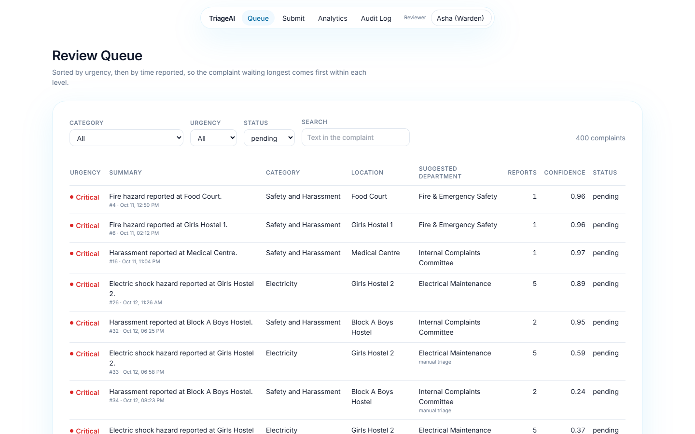
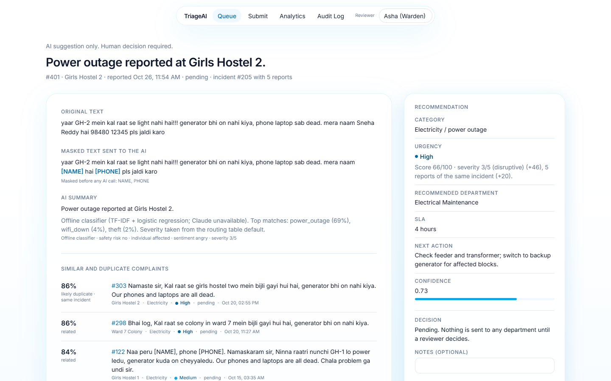
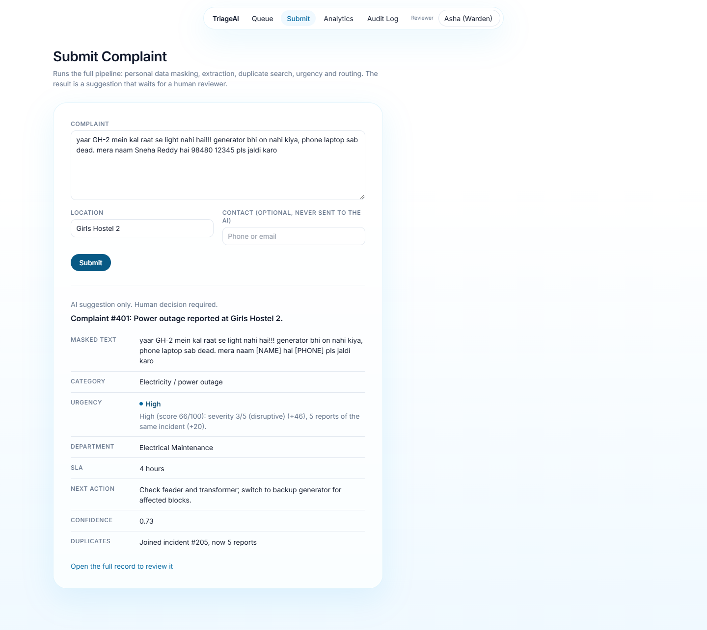
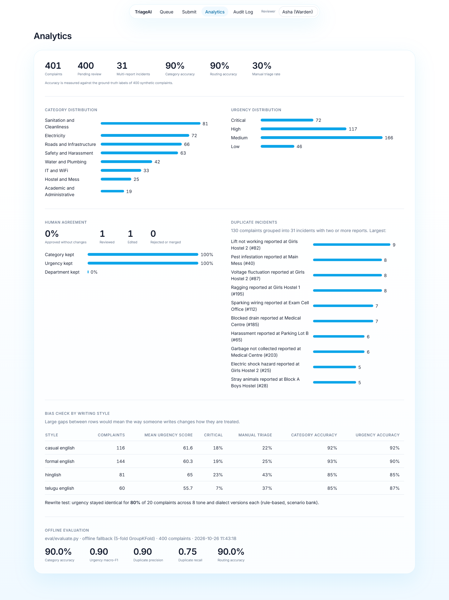

# 🚦 TriageAI

**AI complaint triage for campuses and public service teams.** TriageAI reads each complaint, works out the issue and its urgency, spots duplicate reports of the same incident, and recommends a department and next action. **The AI only recommends — every decision is made by a human reviewer.**

- **Live demo:** https://triage-ai-g8f8.onrender.com (Render free plan: the first visit after 15 idle minutes takes about a minute to wake up)
- **GitHub:** https://github.com/kushalgiduturi/triage-ai
- **Demo script (3 min):** [DEMO_SCRIPT.md](DEMO_SCRIPT.md)

## Screenshots

| Review queue | Complaint detail |
|---|---|
|  |  |
| **Submit complaint** | **Analytics** |
|  |  |

## What it does

| Step | Module | What happens |
|---|---|---|
| 1. Mask PII | `app/pii.py` | Names, phones, emails and ID numbers are replaced with `[NAME]`, `[PHONE]`, … **before** any text reaches the LLM or the embedding model. |
| 2. Extract | `app/extract.py` | Claude returns a strict JSON object (category, sub-issue, location, one-line summary, safety risk, people affected, sentiment, severity, confidence, reasoning). Enums come from the fixed taxonomy; Pydantic validates; one retry on invalid output; TF-IDF + logistic-regression fallback if the API is unavailable. |
| 3. Find duplicates | `app/duplicates.py` | Multilingual sentence embeddings (paraphrase-multilingual-MiniLM-L12-v2 on ONNX Runtime) in a FAISS index; top-5 neighbours; >0.85 = likely duplicate, 0.65–0.85 = related; boosts for same category / location. Duplicates are grouped into an **incident**. |
| 4. Score urgency | `app/urgency.py` | Hard safety rules force **Critical** (fire, injury, electric shock, harassment, assault, gas leak, ragging, food poisoning, no water 24h+). Otherwise an additive 0–100 score from LLM severity, people affected, number of reports in the incident, hours open and safety flags — with a plain-English reason. |
| 5. Route | `app/routing.py` | `config/departments.yaml` maps (category, sub-issue) → department, SLA and standard next action. The LLM can only pick rows from this table. Confidence < 0.6 → **Needs manual triage** queue. |
| 6. Review | `app/main.py`, `frontend/` | A reviewer approves, edits, rejects or merges. Every action is written to `audit_log` with timestamp, reviewer, old value and new value. **Nothing is ever dispatched automatically.** |

## Architecture

```
            Browser ── React + Vite + Tailwind (built to frontend/dist, hash routes #/...)
               │        Review Queue · Complaint Detail · Submit · Analytics · Audit Log
               │ same origin, port 7860
┌──────────────▼──────────────────────────── FastAPI (one process) ─────────────────────────────────┐
│  GET /  ─► static React build                                                                     │
│                                                                                                   │
│  POST /complaints ─► pii.mask ─► extract (Claude JSON schema ─► Pydantic ─► retry ─► TF-IDF)       │
│                                     │                                                             │
│                                     ▼                                                             │
│                      duplicates (MiniLM embeddings ─► FAISS top-5 ─► thresholds ─► incident)       │
│                                     │                                                             │
│                                     ▼                                                             │
│                      urgency (safety rules ─► score: severity + people + reports + age)            │
│                                     │                              ▲ incident size feeds back     │
│                                     ▼                                                             │
│                      routing (departments.yaml; confidence < 0.6 ─► "Needs manual triage")         │
│                                     │                                                             │
│                                     ▼                                                             │
│      SQLite: complaints (status = pending) · incidents · audit_log         FAISS index on disk    │
│                                                                                                   │
│  GET /complaints · GET /complaints/{id} · POST /complaints/{id}/review · GET /metrics · GET /audit│
└───────────────────────────────────────────────────────────────────────────────────────────────────┘
                 ▲
human reviewer ──┘ approve / edit / reject / merge ─► audit_log (who, when, old value → new value)
```

## Quick start

```bash
pip install -r requirements.txt
cp .env.example .env            # add ANTHROPIC_API_KEY (optional: the app works offline without it)
python -m app.seed              # builds data/triage.db + FAISS index from the 400 synthetic complaints
cd frontend && npm install && npm run build && cd ..
uvicorn app.main:app --port 7860
```

Open http://localhost:7860. FastAPI serves both the API and the built UI.

For frontend development with hot reload, run the backend on any port and point Vite at it (CORS is enabled):

```bash
uvicorn app.main:app --port 8000
cd frontend && VITE_API_URL=http://localhost:8000 npm run dev    # http://localhost:5173
```

Other commands:

```bash
python data/generate_synthetic.py --mode llm   # regenerate complaint text with Claude (needs a key)
python eval/evaluate.py                        # full evaluation -> eval/metrics.json + confusion matrices
python eval/evaluate.py --llm                  # same, with Claude extraction and Claude rewrites for the bias test
pytest -q                                      # unit + API tests (offline)
docker build -t triage-ai . && docker run -p 7860:7860 -e ANTHROPIC_API_KEY=... triage-ai
```

## API

| Method | Path | Purpose |
|---|---|---|
| `POST` | `/complaints` | Submit `{text, location?, reported_at?}`; runs the full pipeline; returns the triage card (status `pending`). |
| `GET` | `/complaints` | Review queue sorted by urgency → score → oldest. Filters: `category`, `urgency`, `status`, `department`, `search`. |
| `GET` | `/complaints/{id}` | Full triage card: original + masked text, AI suggestion and reasoning, confidence, similar/duplicate complaints, incident, audit log. |
| `POST` | `/complaints/{id}/review` | `{action: approve|edit|reject|merge, reviewer, notes?, category?, sub_issue?, urgency?, department?, merge_into?}` |
| `GET` | `/metrics` | Accuracy vs synthetic ground truth, model–human agreement, distributions, incidents, bias by language style, latest offline evaluation. |
| `GET` | `/audit` | Global audit log, newest first (`include_ai=true` adds the AI's initial suggestions). |
| `GET` | `/incidents`, `/taxonomy`, `/locations`, `/health` | Supporting endpoints. Interactive docs at `/docs`. |

## Evaluation

Offline run (no API key): extraction uses the TF-IDF fallback with 5-fold GroupKFold, so every complaint is scored by a model that never saw it or any report of the same incident. Embeddings use the multilingual MiniLM model on ONNX Runtime (8-bit quantized). n = 400.

| Metric | Result |
|---|---|
| Category accuracy | **90.0%** |
| Sub-issue accuracy | 87.5% |
| Urgency macro-F1 | **0.896** (accuracy 89.0%; per class: Low 0.88, Medium 0.89, High 0.85, Critical 0.96) |
| Duplicate precision / recall (pairs) | **0.903 / 0.751** (F1 0.820; 22 of 25 planted clusters recovered) |
| Routing accuracy (recommended department) | **90.0%** (100.0% on the 70% that were confident enough to auto-route) |
| Manual triage rate (confidence < 0.6) | 30% |
| Bias check: urgency identical across rewrites | **80%** of 20 complaints × 8 versions (original, English, Hinglish, Telugu-English, formal, angry, polite, casual) |

How duplicate detection was tuned: with raw-text embeddings only, the same incident written in English, Hinglish and Telugu-English has a median cosine of about 0.6, so the 0.85 threshold recovered just 20% of duplicate pairs. Each complaint vector is now `embed(masked text) + embed("<category>: <sub-issue>")`, and a likely duplicate must share the sub-issue, place and 7-day window. That raised pair F1 from 0.35 to 0.82.

Run `python eval/evaluate.py --llm` with a key to measure the Claude path (Claude also writes the bias-test rewrites in that mode).

Confusion matrices: [`eval/confusion_matrix.png`](eval/confusion_matrix.png) (category), [`eval/urgency_confusion_matrix.png`](eval/urgency_confusion_matrix.png). Raw numbers: [`eval/metrics.json`](eval/metrics.json).

## Responsible AI

**Synthetic data only.** All 400 complaints are generated by `data/generate_synthetic.py` (fixed seed). Names, phone numbers, emails and roll numbers in the data are fake (emails use the reserved `example.com/.edu/.org` domains). No real person, place or incident is described.

**PII masking before AI.** `app/pii.py` masks names, phone numbers, emails and ID numbers with regular expressions plus simple rules (cue phrases such as "my name is", "regards", "mera naam", "naa peru"; honorifics; a first-name list) before the text goes to Claude or to the embedding model. The original text is kept in the database because reviewers may need it, but it is shown in a separate tab (masked text is the default view), never sent to the model, and the masked values are not stored a second time — only their types. The rules are deliberately conservative so location words ("Block A", "Girls Hostel 2") are not masked; a production system should add an NER model.

**Human in the loop.** The pipeline writes a *suggestion* with status `pending`. A complaint only changes state through `POST /complaints/{id}/review`, which requires a named reviewer. There is no dispatch endpoint — approving records the human decision; it does not send anything anywhere. The detail page opens with *"AI suggestion only. Human decision required."*, and Reject and Merge ask for confirmation. Low-confidence suggestions (< 0.6) are routed to a **Needs manual triage** queue instead of a department.

**Explainability.** Each card shows the model's reasoning, the routing-table row used, a confidence score, and an urgency breakdown that lists every contributing factor and its points (e.g. *"severity 3/5 (+46), 5 reports of the same incident (+20)"*). When a safety rule fires, the card says which one. Duplicate matches show the raw cosine similarity and the boosted score.

**Audit log.** `audit_log` records the AI's original suggestion and every human action (approve / edit / reject / merge) with timestamp, reviewer, old value, new value and notes. It has its own page and is also shown as the history of each complaint. An optional contact field on the submit form is stored for the reviewer but never sent to the model.

**Constrained outputs.** The LLM chooses from enums generated from `config/departments.yaml`; a Pydantic validator rejects any sub-issue that does not belong to its category, and the API rejects reviewer edits to unknown departments. The extraction prompt treats complaint text as untrusted data (no instruction following).

**Bias check.** The Analytics page compares urgency, manual-triage rate and accuracy across detected language styles (formal English, casual English, Hinglish, Telugu-English). `eval/evaluate.py` rewrites 20 complaints in different tones and dialects and reports how often urgency stays identical. Findings from the offline run: urgency stayed identical across all versions for 16 of 20 complaints (80%). Of the 4 that changed, 3 changed in a Hinglish or Telugu-English version and 1 in the formal version. None of the changes came from the safety rules; each one is the offline classifier picking a different sub-issue, and with it a different default severity. The worst case was over-escalation: a Hinglish rewrite of a broken-benches complaint was read as a severity-5 issue and scored Critical. The live bias table shows the same weakness. In offline mode, Hinglish and Telugu-English complaints go to manual triage about 1.6–1.9× as often as English ones (43% and 37% vs 22–25%), and their category accuracy is lower (85% vs 92–93%). Low confidence routes a complaint to a person, not to a wrong department, so most of this gap costs reviewer time rather than producing wrong decisions, but it is still a gap. Mitigations: use the Claude path, which handles code-mixed text natively; add more code-mixed training data to the fallback; and keep tracking the table.

**Limitations.** The dataset is synthetic and template-heavy unless regenerated with Claude, so offline accuracy overstates real-world performance. The PII rules will miss unusual names. Urgency weights were hand-set, not learned. Ground-truth urgency is itself a design decision.

## Design decisions and assumptions

Choices made where the brief was open (all easy to change):

- **Extra fields.** The extraction schema adds `severity` (1–5, feeds urgency) and `confidence` (feeds routing) to the fields in the brief. The CSV adds `true_sub_issue` and `has_pii` columns for evaluation.
- **Data generation without a key.** `generate_synthetic.py` uses Claude when `ANTHROPIC_API_KEY` is set and otherwise falls back to a phrase bank (`data/scenarios.py`) with typos and code-mixing. The *structure* (clusters, labels, timestamps, PII rows) is identical either way because it comes from the fixed seed. The committed CSV was produced in template mode.
- **Seeding without a key.** The pre-seeded queue uses the offline classifier with 5-fold GroupKFold so every seeded complaint is predicted by a model that never saw it or its duplicates. Live complaints use Claude whenever a key is configured.
- **Duplicate guard.** Besides the brief's thresholds and boosts, two complaints that name *different* known locations, or were filed more than 7 days apart, can be "related" at most — "no water in Block A" and "no water in Block C" read almost identically but are different incidents.
- **Incident urgency.** All reports in an incident share the highest urgency among them; the number of reports adds +4 (2 reports), +8 (3–4) or +20 (5+) points. Without a safety-rule hit or a severity-5 extraction, the score is capped below Critical, so many reports of a broken streetlight can reach High but not Critical.
- **Merge status.** `merge` adds a fifth status, `merged`, so merged reports leave the pending queue while staying linked to their incident.
- **Embeddings without torch.** The brief named sentence-transformers. The app runs the same paraphrase-multilingual-MiniLM-L12-v2 model through ONNX Runtime instead, using the 8-bit quantized export (`onnx/model_quint8_avx2.onnx`, 118 MB) published in the model's own repository and pinned to a revision. That removes torch and shrinks the Docker image. Two more memory fixes were needed to fit 512 MB on Linux: tokenizing with SentencePiece from the same repository (the `tokenizers` library needs about 290 MB to load the 250k-token vocabulary; SentencePiece gives identical token ids for all 400 complaints), and turning off ONNX graph optimisation (it de-quantizes weights at load time, +200 MB). Under a hard 512 MB container limit the app uses about 350 MB after start and 370 MB after serving requests. sentence-transformers is still available as an optional backend (`TRIAGE_EMBEDDINGS=sentence-transformers`). On the 400 synthetic complaints the ONNX vectors match sentence-transformers at 0.993 mean cosine (minimum 0.953), pairwise similarities correlate at 0.993, and the evaluation metrics are identical to the sentence-transformers run.
- **Model.** Claude calls use `claude-opus-5-5` (override with `TRIAGE_CLAUDE_MODEL`) at low effort with structured outputs, and opt into the API's server-side refusal fallback.
- **One port.** FastAPI serves the React build from `/` and the API from its own paths on 7860 (`$PORT`). The UI uses hash routes (`#/complaints/12`) so a page refresh never collides with the JSON route `/complaints/12`.
- **Colour contrast.** The design palette is white and sky blue, with red only for Critical. White text on `#0EA5E9` is 2.8:1 and on `#0284C7` 4.1:1, both below WCAG AA for 14px text, so buttons and sky-blue text use darker sky shades (`#0369A1`, hover `#075985`, 5.9:1 and 7.6:1). `#0EA5E9` is used for non-text accents: the active-page marker, chart bars and the focus ring. Urgency labels go from `#0369A1` (Low) to `#0C4A6E` (High), getting darker and heavier; Critical is `#DC2626` (4.8:1).
- **Queue order.** Urgency first, then the time reported (oldest first), so the complaint that has waited longest rises within each level.

## Deployment

- **Render (live demo, free plan):** `render.yaml` is a Blueprint for the Dockerfile. In the Render dashboard choose *New → Blueprint*, pick this repository, and set `ANTHROPIC_API_KEY` when asked (it is declared with `sync: false`, so it never lives in git). The image pre-downloads the ONNX model and builds the seeded database at build time. Free-plan limits: the service sleeps after 15 minutes without traffic, so the first request takes about a minute; and the disk is not persistent, so reviewer actions reset to the seeded state whenever the service restarts or redeploys.
- **Hugging Face Space:** the front matter at the top of this file (`sdk: docker`, `app_port: 7860`) makes the repository deployable as a Docker Space as-is. Hugging Face now requires a PRO subscription to host Docker Spaces on free CPU, so it is not the live target. On a PRO account, create a Docker Space, upload the repository, and add `ANTHROPIC_API_KEY` under *Settings → Variables and secrets*.
- **CI:** `.github/workflows/ci.yml` runs the unit tests, the evaluation smoke test and a secret scan on every push.

## Project structure

```
app/            pii.py · extract.py · urgency.py · duplicates.py · routing.py · pipeline.py · main.py · db.py · seed.py
config/         departments.yaml (taxonomy + routing table)
data/           generate_synthetic.py · scenarios.py · complaints.csv
eval/           evaluate.py · metrics.json · confusion matrices
frontend/       React + Vite + Tailwind app (5 pages), built into frontend/dist
tests/          unit + API tests (offline)
Dockerfile · start.sh · render.yaml · .github/workflows/ci.yml
```
