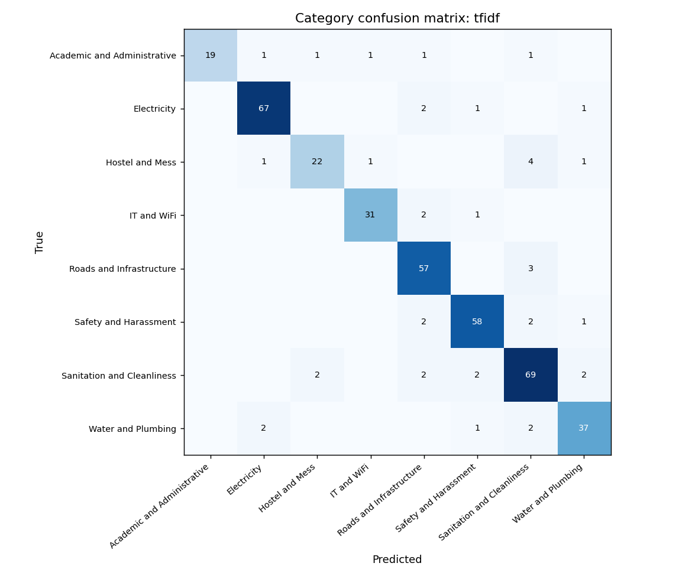

# TriageAI results

All numbers are reproducible. Dataset: 400 synthetic complaints, seed 42.

Measured on 2026-10-26 on a laptop (Intel Core i7-13620H, 40 GB RAM, Windows 11, Python 3.11.9, CPU only), with the Lite edition embeddings (ONNX Runtime). Raw outputs are in [`eval/results/`](../eval/results). Every row below names the command that produced it; on a machine without `make`, run the Python command inside that target directly (see the [Makefile](../Makefile)).

## Main comparison

Both systems run through the same pipeline (PII masking, duplicate detection, urgency scoring, routing). Only the extraction step differs:

- **Rule-only:** hand-written keyword rules ([`app/baselines.py`](../app/baselines.py)), no training.
- **TF-IDF + LogReg:** the offline classifier that TriageAI uses when no LLM is available, evaluated with 5-fold GroupKFold so no complaint, or any report of the same incident, is in its own training fold.

| Metric | Rule-only | TF-IDF + LogReg | Reproduce command |
|---|---|---|---|
| Category accuracy | 0.930 | 0.900 | `make eval-category` |
| Urgency macro-F1 | 0.885 | 0.898 | `make eval-urgency` |
| Duplicate precision (thr 0.85) | 0.912 | 0.896 | `make eval-dupes` |
| Duplicate recall (thr 0.85) | 0.841 | 0.752 | `make eval-dupes` |
| Routing accuracy | 0.925 | 0.900 | `make eval-routing` |
| Latency per complaint (s), mean / p95 | 0.036 / 0.051 | 0.040 / 0.056 | `make eval-latency` |
| Cost per 1000 complaints (USD) | 0.00 (1) | 0.00 (1) | `make eval-cost` |

(1) No API calls; the systems run on the local CPU. Hardware cost is not priced.

The LLM extraction path (Claude, or Ollama with `PROVIDER=ollama`) is not part of this evaluation, so none of these numbers describe it. With a reachable provider, `make eval` adds it as a third system.

Supporting numbers from the same runs: sub-issue accuracy 0.910 (rule) and 0.875 (TF-IDF); planted duplicate clusters recovered as one incident 25 of 25 (rule) and 22 of 25 (TF-IDF); share sent to manual triage because confidence was below 0.6: 18.3% (rule) and 29.8% (TF-IDF).

**The rule-only baseline scores higher than the learned classifier on most metrics.** This is not evidence that rules beat learning. The same person wrote the keyword rules and the phrase bank that generated the data, so the rules match the generator's vocabulary almost word for word. See the limitations below.

Category confusion matrices: [rule-only](confusion_rule.png), [TF-IDF + LogReg](confusion_tfidf.png).

## Safety and fairness

| Check | Result | Reproduce command |
|---|---|---|
| PII leak test, tuning set | 0 of 453 PII values reached the LLM prompt (0 of 120 complaints). Before the masker fixes in this release: 144 of 453 leaked, in 89 of 120 complaints. | `make test-pii` |
| PII leak test, held-out set | **240 of 444 PII values leaked, in 120 of 120 complaints.** All 240 leaks are names; phones, emails and ID numbers: 0 leaked. | `make test-pii` |
| Location codes wrongly masked (BH-A, GH-2, Block C, ...) | 0 of 120 (tuning set), 0 of 120 (held-out set) | `make test-pii` |
| Bias consistency (urgency identical across 8 tone and dialect versions, 20 complaints) | Rule-only 85%, TF-IDF + LogReg 80% | `make test-bias` |
| Human override rate | not measured (3) | `make eval-agreement` |

The PII test builds 120 complaints in Hinglish, Telugu-English and Indian English with Indian names, Indian phone formats (`+91 98480 12345`, `098480 12345`, `984 801 2345`, ...), emails, roll numbers (including JNTU-style codes such as `20774A65G6`), Aadhaar-style numbers and hostel codes. Each complaint goes through the real pipeline with a recording stand-in for the LLM, and the exact prompt is checked for every planted value. Every miss is saved to [`eval/pii_misses.json`](../eval/pii_misses.json) and [`eval/pii_misses_heldout.json`](../eval/pii_misses_heldout.json); the pre-fix misses are kept in [`eval/pii_misses_before_fix.json`](../eval/pii_misses_before_fix.json).

**How to read the two PII results.** The masker rules were improved using the misses on the tuning set, so 0 leaks there shows the fixes work on those phrasings and nothing more. The held-out set uses different names and sentence patterns that were written before its results were seen and were never used for tuning. On it, every name leaked. Rule-based name detection does not generalise to new phrasings. Structured identifiers (phones, emails, roll and Aadhaar numbers) did generalise. A real deployment needs a trained name recogniser; see the upstream contribution work in the README.

(3) The audit-log script works, but the only review actions recorded so far are 5 scripted UI tests, not human decisions, so no override rate is reported.

### Comparison with Microsoft Presidio

The same 240 cases run through Presidio's default `AnalyzerEngine` (presidio-analyzer 2.2.365, spaCy 3.8.16, `en_core_web_lg` 3.8.0). A value counts as leaked if any occurrence is not covered by a detection of any type.

| PII values leaked | TriageAI rules, tuning set | Presidio, tuning set | TriageAI rules, held-out set | Presidio, held-out set |
|---|---|---|---|---|
| Names | 0 of 209 | 51 of 209 | 240 of 240 | 30 of 240 (4) |
| Phone numbers | 0 of 109 | 0 of 109 | 0 of 94 | 0 of 94 |
| Emails | 0 of 36 | 0 of 36 | 0 of 56 | 0 of 56 |
| IDs (roll and Aadhaar-style numbers) | 0 of 99 | 99 of 99 (5) | 0 of 54 | 53 of 54 |
| Hostel and block codes flagged as PII | 0 of 120 | 35 of 120 | 0 of 120 | 30 of 120 |

(4) Presidio's statistical name recognition generalises to unseen phrasings far better than TriageAI's rules, but the default English model also tags romanized Hindi and Telugu words as people ("raat se", "light nahi hai", "Shikayat karta"), which over-masks the complaint.
(5) Roll numbers are not a Presidio entity, and the Aadhaar-style numbers in the test are random digits that correctly fail the Aadhaar checksum. The India-specific recognizers are off by default; with `InAadhaarRecognizer` added, a checksum-valid number is detected in plain, spaced and dashed formats.

Presidio also labels valid Indian mobile numbers as `DATE_TIME` with a higher score than `PHONE_NUMBER`: after default conflict resolution, 32 of the 203 phone numbers would be anonymized as `<DATE_TIME>`. This is reported upstream (see the README). Reproduce: `python eval/pii_leak_test.py --dump-cases eval/results/pii_cases.json`, then `python eval/presidio_compare.py eval/results/pii_cases.json` in an environment with `presidio-analyzer` and `en_core_web_lg`.

## Time saved

| | Minutes per complaint | Sample size | Status |
|---|---|---|---|
| Manual triage (read, categorise, check duplicates, choose a department, log it) | not measured | 0 | No human participant was available to time. |
| TriageAI processing (machine time) | 0.0007 (0.040 s) | 400 | Measured, TF-IDF path, from `make eval-latency` |
| Human review of a TriageAI suggestion | not measured | 0 | No human participant was available to time. |

**Estimate, not measured:** if manual triage takes about 3 minutes per complaint (reading, searching earlier complaints for duplicates, looking up the right department and SLA, logging) and reviewing a prepared triage card takes about 1 minute, the saving is about 2 minutes per complaint, or about 10 hours a week for 300 complaints. These per-step times are assumptions, not observations.

To measure it properly: give one person 20 complaints from `data/complaints.csv` to triage by hand with a spreadsheet and a timer, then a different 20 in the TriageAI review queue, and record minutes per complaint for each.

## Error analysis

Top failure cases of the TF-IDF + LogReg path, which is what the live demo uses without an API key. Source: `eval/results/tfidf_predictions.csv`.

1. **Neighbouring sub-issues share vocabulary.** WiFi down was predicted as slow internet 3 times, for example C0008: *"Central library mein WiFi connected dikhata hai par internet nahi chal raha."* Both route to IT Services, so routing was still right. Fix next: let the LLM path decide these, or add explicit features for "connected but no internet".
2. **Place names pull the classifier towards other issues at the same place.** C0308 (*"ECE department lo lift moodu rojulu nunchi pani cheyyatledu"*) was predicted as dirty washrooms; C0031 (a faculty complaint at the workshop) as a power outage. Duplicate clusters teach the model that a place implies an issue, even with down-weighting. Fix next: replace known location names with a placeholder before classification.
3. **Code-mixed words the model has rarely seen.** C0044 (*"kukkalu bikes venaka parigedutunnayi"*, dogs chasing bikes) was predicted as dirty washrooms; C0034 (*"aawara kutton ka jhund ... peecha karta hai"*) as harassment, because *peecha* (following) also appears in harassment complaints. Fix next: more Hinglish and Telugu-English training text per issue, or the LLM path.
4. **One misclassified report splits an incident.** A likely duplicate must share the sub-issue, so a single wrong sub-issue breaks the chain. Cluster D18 (mess hygiene, 6 reports) became 4 incidents because 4 reports were misclassified, and D13 (stray dogs, 8 reports) became 4 incidents. This is the main cause of the recall gap (0.752 against 0.841 for the rule baseline). Fix next: allow a duplicate when the text similarity is very high even if the sub-issue differs, and let reviewers merge (already supported).
5. **Urgency errors at the Medium and High boundary.** 43 urgency errors: 16 Medium predicted as High and 11 High predicted as Medium. 17 of the 43 happen even when the sub-issue is correct, so they come from the urgency heuristics (people affected, report counts, time-critical words), not from classification. Fix next: calibrate the urgency weights on real reviewer decisions once the audit log has them.

## Limitations of this evaluation

- **Synthetic labels.** Every label comes from the generator, which decides the "true" category, urgency and department. Real complaints are messier and their labels are disputed.
- **Same-generator bias.** One person wrote the scenario phrase bank, the keyword rules, the urgency rules and the PII rules. Systems built by that person match the data better than they would match real complaints. The rule baseline's lead is the clearest sign.
- **Small sample.** 400 complaints, 25 planted duplicate clusters, 20 complaints in the bias test and 120 in each PII set. Differences of a few points are within noise.
- **Thresholds tuned on generated clusters.** The duplicate rules (issue-anchored embeddings, the sub-issue guard, the 7-day window) were tuned on the same 400 complaints they are measured on.
- **The template text is easier than real text.** The committed dataset was generated from templates because no API key was available. Regenerating it with Claude (`python data/generate_synthetic.py --mode llm`) would produce more varied text and lower scores.
- **The LLM path is not evaluated.** All numbers describe the offline paths only.
